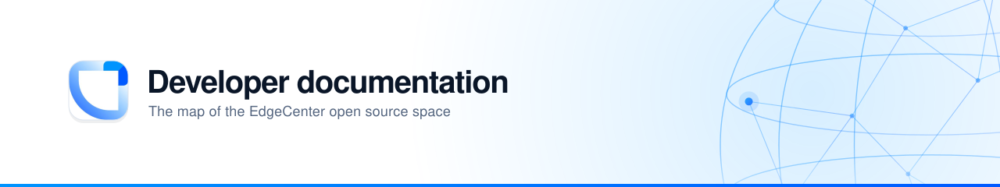
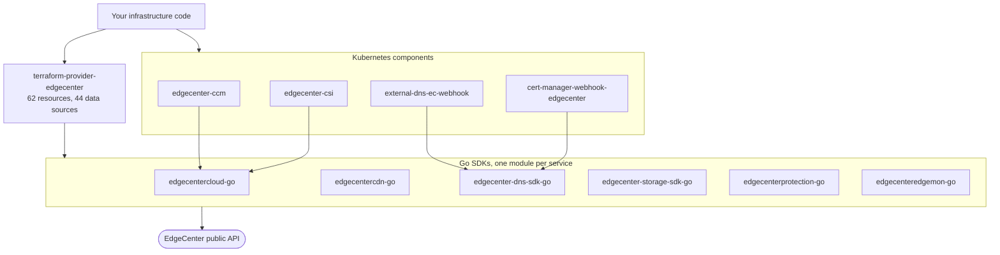

<div align="center">
<picture>
  <source media="(prefers-color-scheme: dark)" srcset="assets/hero-dark.svg">
  
</picture>
</div>

This repository documents the **code** EdgeCenter publishes on GitHub. Product
documentation lives in the [knowledge base](https://edgecenter.ru/knowledge-base)
and the [API reference](https://apidocs.edgecenter.ru); nothing here duplicates
them.

## Contents

| Document | What it answers |
| :--- | :--- |
| [Getting started](docs/getting-started.md) | From an empty directory to a first managed resource, with Terraform or Go |
| [Repository map](docs/repository-map.md) | Every public repository, what it does, who consumes it, how alive it is |
| [Compatibility](docs/compatibility.md) | Which provider release pins which SDK version, and which Go versions are supported |
| [Development](docs/development.md) | Toolchain, make targets, layout and coding standards shared by the Go repositories |
| [Releasing](docs/releasing.md) | Versioning, tagging, and how a change travels from an SDK to Terraform users |
| [Decisions](adr/README.md) | Architecture decision records for choices that outlive a single pull request |

Contribution rules and the security policy are organization-wide and live in
[Edge-Center/.github](https://github.com/Edge-Center/.github).

## The shape of the space

Three layers, and each one is usable on its own.



**The provider is the only top-level consumer of every SDK.** That has one
consequence worth internalising before you touch anything: the provider pins
tagged SDK releases in its `go.mod`, not local paths. An SDK fix reaches
Terraform users only after the SDK is tagged, the provider bumps the pin, and the
provider itself is released. Three steps, not one. [Releasing](docs/releasing.md)
walks through it.

## Which repository do I need

| I want to ... | Repository |
| :--- | :--- |
| Manage cloud, CDN, DNS, storage or protection as code | [terraform-provider-edgecenter](https://github.com/Edge-Center/terraform-provider-edgecenter) |
| Write a Go program against the cloud API | [edgecentercloud-go](https://github.com/Edge-Center/edgecentercloud-go) |
| Automate CDN resources, rules or certificates | [edgecentercdn-go](https://github.com/Edge-Center/edgecentercdn-go) |
| Manage DNS zones and records | [edgecenter-dns-sdk-go](https://github.com/Edge-Center/edgecenter-dns-sdk-go) |
| Give a Kubernetes cluster nodes and load balancers | [edgecenter-ccm](https://github.com/Edge-Center/edgecenter-ccm) |
| Give a Kubernetes cluster persistent volumes | [edgecenter-csi](https://github.com/Edge-Center/edgecenter-csi) |
| Issue certificates through DNS01 | [cert-manager-webhook-edgecenter](https://github.com/Edge-Center/cert-manager-webhook-edgecenter) or [ec-dns-certbot-plugin](https://github.com/Edge-Center/ec-dns-certbot-plugin) |
| Chart CDN traffic in Grafana | [grafana-cdn-datasource](https://github.com/Edge-Center/grafana-cdn-datasource) |

The full inventory, including the parts that are quiet or unmaintained, is in the
[repository map](docs/repository-map.md).

## Authentication, once

Everything in this space authenticates the same way: a permanent API token from
the EdgeCenter control panel, sent as `Authorization: APIKey <token>`.

```sh
export EC_PERMANENT_TOKEN="your-token"
```

The Terraform provider reads that variable, and every SDK takes the token through
its client options. Do not put a token in a committed `.tf` file, and remember
that Terraform state holds whatever the API returns - treat the state file as a
secret.

## Fixing these docs

Open a pull request. Every page is plain markdown and renders on GitHub, so there
is no build step to run and nothing to preview locally beyond a markdown viewer.
