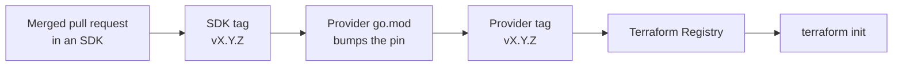

# Releasing

How a change reaches a user, and why an SDK fix is not a user-visible fix yet.

## The chain

Four steps, and each is a separate pull request or action. A fix merged into an
SDK on Monday is invisible to Terraform users until the SDK is tagged, the
provider bumps the pin, and the provider is released. Say so in the SDK pull
request if the fix is urgent, otherwise it silently waits.

Go module consumers are one step shorter: an SDK tag is enough, because they
import the module directly.

## Versioning

Semantic versioning, with the pre-1.0 caveat that applies to most of this space.

- **SDKs** are `v0.x.y` except `edgecentercloud-go`, which is `v2.x.y` and uses the
  `/v2` import path suffix. While a module is below 1.0, a minor bump is allowed
  to break the API - read the diff before bumping.
- **The Terraform provider** is `v0.14.x`. Treat a minor bump as potentially
  behaviour-changing for practitioners: resource schemas, defaults and diff
  behaviour have all moved between minors.
- **Kubernetes components** follow their own lines: `edgecenter-csi` is at `v1.x`,
  `edgecenter-ccm` at `v2.x`.

Never move a tag once it is pushed. The Go module proxy caches the content of a
tag permanently, and a moved tag produces checksum mismatches for everyone who
already fetched it. Cut a new patch version instead.

## Releasing an SDK

1. Merge everything that belongs in the release.
2. Tag the merge commit on the default branch and push the tag.
3. Write release notes that say what changed for a consumer, not what the commits
   were.

Keep tags on the default branch. `edgecentercdn-go` currently has `v0.2.6` and
`v0.2.7` sitting on an unmerged branch, which makes the checked-out `main` look
as though features are missing and forces everyone to compare against tags
instead of branches. Do not repeat that.

## Releasing the Terraform provider

Pushing a `v*` tag is the whole trigger. The release workflow then:

1. Imports the GPG signing key from repository secrets.
2. Runs GoReleaser, which cross-compiles the binaries, produces the checksum file
   and signs it. The Terraform Registry will not accept an unsigned release.
3. Publishes the GitHub release with those artefacts.
4. Uploads the release to the S3 mirror used by customers who cannot reach the
   public registry.

The Registry picks the release up from the tag on its own, so there is nothing to
upload by hand. Before tagging:

- `go.mod` pins the SDK versions you actually want to ship.
- `make docs` has been run and the regenerated `docs/` tree is committed.
- The changelog entry describes practitioner-visible changes: new resources,
  changed defaults, anything that will show up in a plan.

## Checklist for a coordinated change

When one change spans an SDK and the provider:

- [ ] SDK pull request merged and reviewed
- [ ] SDK tagged, release notes written
- [ ] Provider `go.mod` bumped to the new tag, in its own pull request
- [ ] Provider tests pass against the new SDK
- [ ] Documentation regenerated if a schema moved
- [ ] Provider tagged and the Registry shows the new version
- [ ] [Compatibility table](compatibility.md) updated with the new pins
